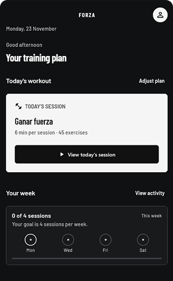
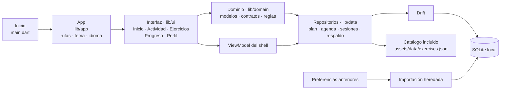

# FORZA

<p align="center">
  
</p>

<p align="center"><strong>Entrena con intención. Sigue tu progreso.</strong></p>

FORZA es una app Flutter para organizar entrenamientos, explorar ejercicios y consultar la actividad y el progreso. Guarda localmente el plan, la agenda y el historial; no requiere una API para esas funciones.

## La app

<p align="center">
  <picture>
    <source media="(min-width: 768px)" srcset="assets/brand/forza-overview.png">
    
  </picture>
</p>

## Estado actual

La app guarda localmente en SQLite (Drift) las preferencias del plan, agenda de 120 días, sesiones terminadas con resultados por serie, objetivos personales, medidas corporales y borrador de la sesión activa. También permite exportar y restaurar un respaldo JSON local. La apariencia, el idioma y los ajustes de perfil se conservan localmente. No hay backend, cuentas reales ni sincronización remota.

El registro de series, recuperación de sesión, agenda sincronizada entre Inicio/Actividad/entrenamiento, medidas corporales persistentes, evolución de fuerza desde las cargas guardadas, métricas de series y respaldo ya están implementados. Los récords personales aún usan datos de demostración. Consulta [auditoría y prioridades](docs/07-auditoria-modulos-indispensables.md) y [módulos recomendados](docs/08-modulos-recomendados.md) para el estado vigente.

## Arquitectura

FORZA usa una estructura por funcionalidades en la capa de interfaz, junto con capas `domain` y `data`. La UI coordina los flujos y consume contratos/modelos del dominio; los repositorios de datos implementan la persistencia local y la carga del catálogo.



La interfaz se organiza por funcionalidades. Las reglas y modelos viven en `domain`; los repositorios de `data` conectan esas reglas con SQLite y los assets locales. Las migraciones SQL y snapshots del esquema están en `database/migrations/sqlite/` y `drift_schemas/`.

**Estado de backend:** no hay API ni sincronización remota implementadas. Los endpoints descritos en la [documentación de persistencia y API](docs/06-datos-locales-y-api.md) son una propuesta futura.

### Mapa del código

| Ruta | Responsabilidad |
|---|---|
| `lib/main.dart` | Inicializa Flutter, formatos de fecha y modos de sistema; arranca la app. |
| `lib/app/` | Configura `MaterialApp`, rutas, tema, apariencia e idioma. |
| `lib/ui/core/` | Scaffold, widgets compartidos y estado de navegación. |
| `lib/ui/features/` | Vistas y componentes agrupados por flujo de producto. |
| `lib/domain/` | Modelos, contratos de repositorio y reglas de entrenamiento independientes de SQLite. |
| `lib/data/repositories/` | Implementaciones para configuración, agenda, historial, objetivos, catálogo y respaldo. |
| `lib/data/database/` | Base SQLite y tablas Drift. |
| `database/migrations/sqlite/` y `drift_schemas/` | SQL de referencia y snapshots versionados del esquema. |
| `assets/data/exercises.json` | Catálogo de ejercicios incluido con la aplicación. |

## Desarrollo

Requisitos: Flutter y Dart compatibles con las versiones declaradas en `pubspec.yaml`.

```sh
flutter pub get
flutter run
```

Para Linux con X11:

```sh
GDK_BACKEND=x11 flutter run -d linux
```

## Documentación

- [Cómo contribuir](CONTRIBUTING.md)
- [Configuración de contribuciones, reglas y APK en GitHub](docs/github-contributions.md)
- [Guía de implementación](docs/01-implementacion.md)
- [Pantallas y módulos](docs/02-modulos-y-pantallas.md)
- [Sistema visual](docs/03-sistema-visual.md)
- [Paquetes y dataset](docs/04-paquetes-y-dataset.md)
- [Persistencia local, migraciones y contrato futuro de API](docs/06-datos-locales-y-api.md)
- [Auditoría de módulos y prioridades del MVP](docs/07-auditoria-modulos-indispensables.md)
- [Módulos recomendados y secuencia de trabajo](docs/08-modulos-recomendados.md)
